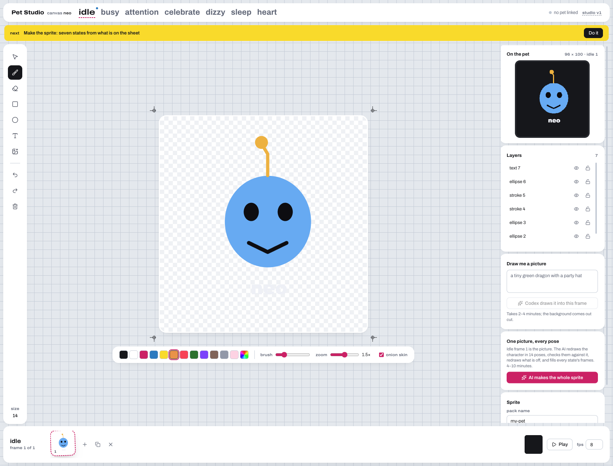
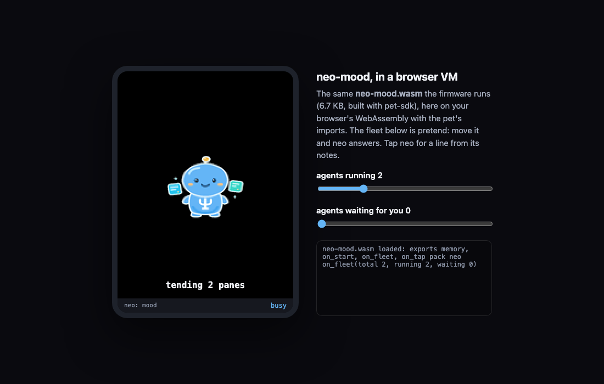

# neo's desk pet: from a prompt to firmware, end to end

A walkthrough of one real run on m5, 2026-10-24: Codex draws neo on a Pet Studio canvas, the canvas becomes a
seven-state sprite, a small WebAssembly app gives neo its moods, and one firmware bundle for the jc3248 board carries
both. Every picture below is from that run.

```
 relic5 Oracle page ── Pet prompt ──▶ Codex ── canvas.ts ──▶ Pet Studio canvas "neo-codex"   (live, WebSocket)
                                                                   │ create_sprite
                                                                   ▼
                    neo-mood.c ── pet-sdk ──▶ neo-mood.wasm     pack "neo" (7 GIFs, 99 KB)
                                     │                             │
                                     └──────────┬──────────────────┘
                                                ▼  POST /api/flasher/stage
                              workspace/flasher/jc3248-neo/  (bootloader, firmware, storage.bin, index.html, .zip)
```

## 1. Codex draws neo on a canvas session

A canvas is a named session: `http://127.0.0.1:4810/?canvas=<name>`. Any agent draws on it with one shell command
per action, and every page open on that canvas updates live over the WebSocket. Codex was given
[`tools/agent-brief.md`](../tools/agent-brief.md) with neo as the character:

```bash
S="$(git -C "$(ghq root)/github.com/Soul-Brews-Studio/relic5" rev-parse --show-toplevel)/pet-studio"
export PET_STUDIO_AGENT=codex
bun $S/tools/canvas.ts neo-codex svg '{"path": "/tmp/neo-codex/char.svg", "x": 62, "y": 70, "width": 260}'
bun $S/tools/canvas.ts neo-codex screenshot '{"width": 96}' > /tmp/neo-codex/check-96.png
bun $S/tools/canvas.ts neo-codex create_sprite '{"name": "neo", "fps": 6}'
```

Run it as `codex exec -s workspace-write -c sandbox_workspace_write.network_access=true …` so the sandbox can reach
the studio on 127.0.0.1. Codex finished in one go (70,863 tokens): the character as one SVG, two frames each for
busy (squash and stretch), heart and sleep, a screenshot of every frame, then the pack.

| idle frame 1 on the canvas | the designer page |
|---|---|
|  |  |

## 2. The sprite

`create_sprite` turns the frames into the pet's seven 96 x 100 GIFs (`workspace/packs/neo/`, 99 KB). States left
empty are made from idle.

| idle | busy | heart | sleep |
|---|---|---|---|
|  |  |  |  |

## 3. neo's mood, as a WebAssembly app

[`apps/neo-mood.c`](../apps/neo-mood.c) is a pet app: C against esp32-oracle's `lab/pet-sdk/pet.h`, built to a
6.7 KB `.wasm`. The pet's firmware runs it in WAMR; it reacts to the fleet OraclePet reports.

| the fleet | neo shows | caption |
|---|---|---|
| agents waiting | attention | `2 need neo` |
| agents running | busy | `tending 4 panes` |
| all quiet | idle, then sleep after a minute | `fleet calm`, `zzz, all done` |
| the last waiting agent answered | the heart and a blip | `all answered` |
| a tap | the heart | one of neo's lines in turn: `look before`, `never guess`, `maw hey` … |

```bash
cd "$(ghq root)/github.com/Soul-Brews-Studio/esp32-oracle/lab/pet-sdk"
cp <relic5>/pet-studio/apps/neo-mood.c examples/ && ./build.sh examples/neo-mood.c   # -> build/neo-mood.wasm
```

The same `.wasm` runs in a browser too: a page gives it the pet's imports (`show`, `react`, `caption`, `pack`,
`millis` …), shows the neo GIFs, and turns two sliders into the fleet. That page is kept on neo's page in the relic5
hub (Oracles tab) as an artifact.



## 4. One firmware bundle: the sprite and the app

```bash
curl -X POST http://127.0.0.1:4810/api/flasher/stage -H 'content-type: application/json' \
  -d '{"board": "jc3248", "pack": "neo", "apps": ["neo-mood"], "autorun": "neo-mood"}'
```

It builds the firmware with ESP-IDF v6, bakes only the chosen pack and apps into the storage image, and writes a web
flasher: `workspace/flasher/jc3248-neo/` (`bootloader.bin`, `partition-table.bin`, `ota_data_initial.bin`,
`jc3248_pet_idf.bin` 1.4 MB, `storage.bin` with 124 KB used of 3 MB, `index.html`, and a `.zip`). The storage image
holds `/characters/neo/` (seven GIFs), `/apps/neo-mood.wasm` and `/apps/autorun`, so the pet boots neo and starts the
app. Flash it from `index.html` in Chrome over USB, or `studio_flash_ble {"kind": "firmware", "board": "jc3248"}`
through OraclePet.

### Speed (measured on m5)

| what | before | now |
|---|---|---|
| first build in a fresh build folder | 34.3 s | 34.3 s (once) |
| the same bundle again | 3.8 s | 3.8 s |
| a bundle for **another pack** | 18-20 s (recompile and relink) | **3.3 s** |

A one-pack bundle no longer compiles the pack's name into the firmware. `gif.cpp` boots "the first pack found" when
`PET_DEFAULT_PACK` is empty, and the storage image holds only that pack, so one firmware build serves every sprite and
a new sprite costs only a new storage image. Bundles with several packs still name the one that boots.

### Two accounts, one firmware folder

On m5 the firmware's `build/` was first configured by another account's ESP-IDF (`/Users/nat/esp/esp-idf`), and a
build by `beta` stopped at the bootloader: "does not match the source … used to generate cache". The server now checks
the app's and the bootloader's CMake caches and, when either was made by another ESP-IDF, builds in
`<dir>-<user>` (`build-beta`) instead of touching the other account's build.
